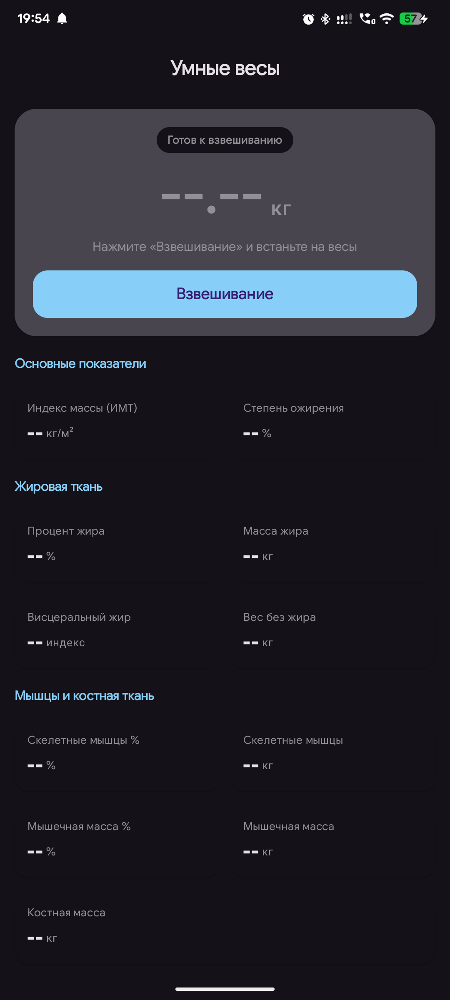
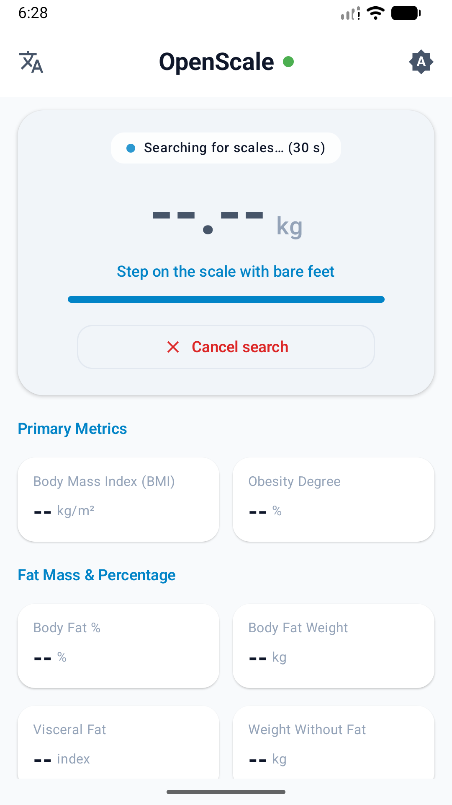
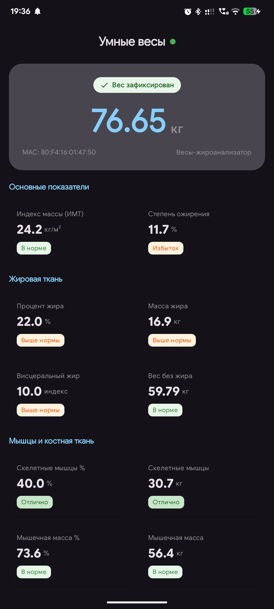
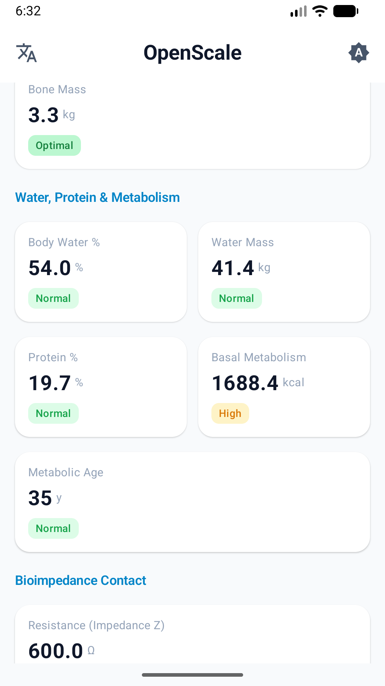
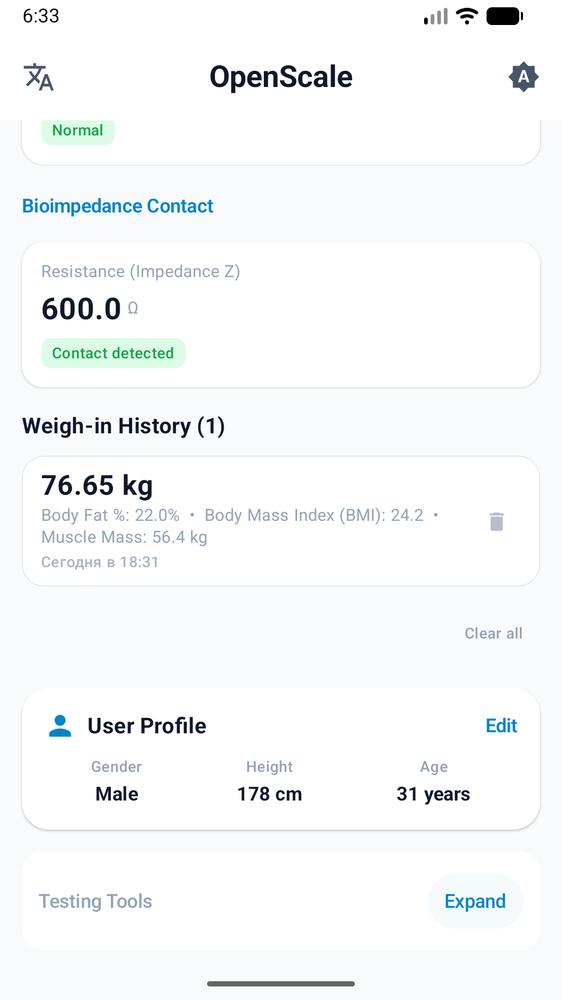
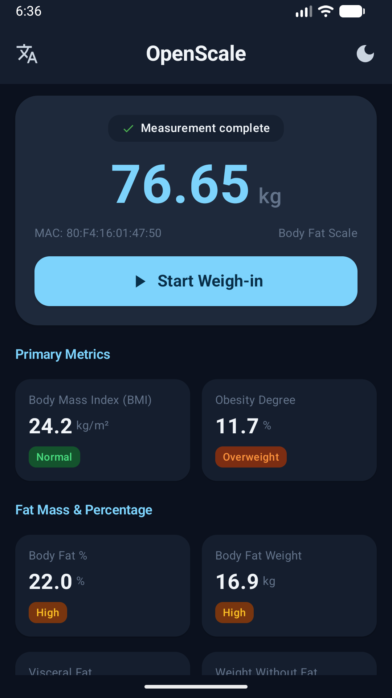
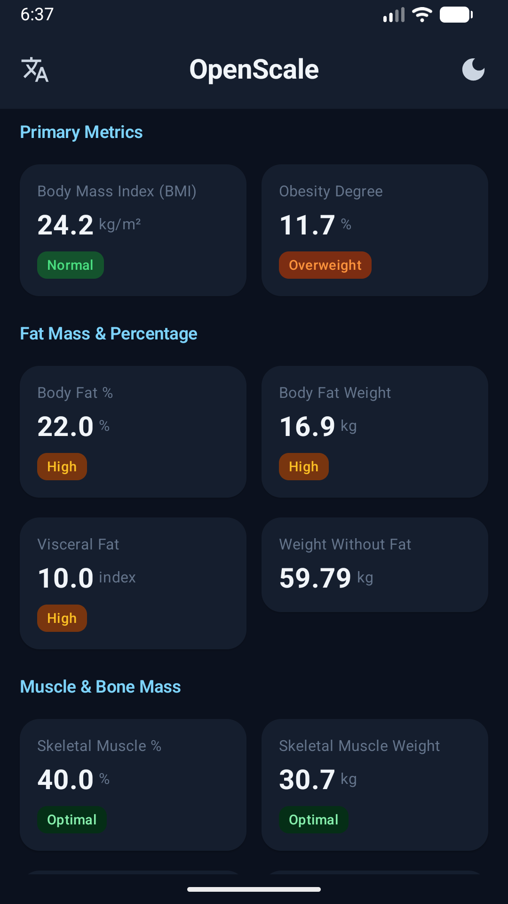
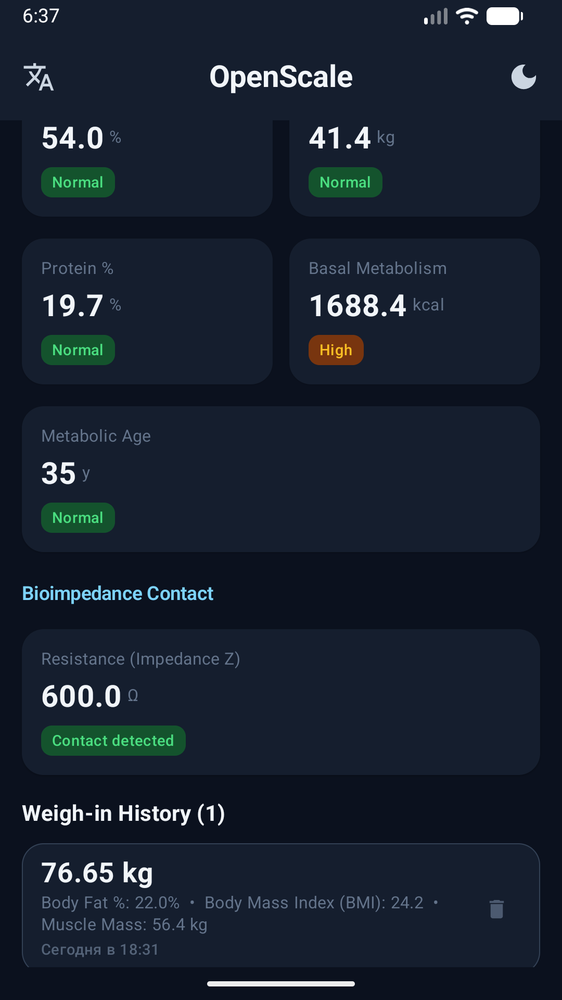

# OpenScaleApp ⚖️

[](https://github.com/shlyahten/OpenScaleApp/releases/latest)
[-16a34a?logo=android)](https://github.com/shlyahten/OpenScaleApp/releases/download/v1.0.0/OpenScaleApp-v1.0.0.apk)
[](LICENSE)

**OpenScaleApp** is a modern, privacy-first, open-source Android application for Bluetooth Low Energy (BLE) smart body fat scales powered by the **Chipsea / OKOK protocol**.

📥 **[Download Latest APK (v1.0.0)](https://github.com/shlyahten/OpenScaleApp/releases/download/v1.0.0/OpenScaleApp-v1.0.0.apk)**

---

## 📱 Screenshots

### Light Mode
<div align="center">

| 1. Ready to Weigh | 2. Active Weigh-In | 3. Locked Metrics | 4. Full Body Composition | 5. History & Profile |
|:---:|:---:|:---:|:---:|:---:|
|  |  |  |  |  |

</div>

### Dark Mode
<div align="center">

| 6. Main Dashboard (Dark) | 7. Composition Metrics (Dark) | 8. History & Diagnostics (Dark) |
|:---:|:---:|:---:|
|  |  |  |

</div>

---

## 🌟 Key Features

* **⚡ Smart 1-Tap Weigh-In**:
  * On-demand 30-second Bluetooth scanning with visual countdown progress.
  * **Automatic scan termination**: stops scanning immediately when the weight stabilizes and bioimpedance is acquired (or 2.5s fallback for non-conductive footwear), drastically reducing battery drain.
* **🧬 17 Full Body Composition Metrics**:
  * **Primary**: Body Mass Index (BMI), Obesity Degree
  * **Fat Tissue**: Body Fat %, Fat Mass (kg), Visceral Fat Index, Weight Without Fat / Lean Mass (kg)
  * **Muscle & Bone**: Skeletal Muscle %, Skeletal Muscle Mass (kg), Muscle %, Muscle Mass (kg), Bone Mass (kg)
  * **Hydration & Metabolism**: Body Water %, Water Mass (kg), Protein %, Basal Metabolic Rate (BMR in kcal), Metabolic Body Age
  * **Bioimpedance**: Contact detection & alternating resistance (Impedance $Z$ in $\Omega$)
* **📈 History & Record Browsing**:
  * Automatically archives completed weigh-ins with precise timestamp.
  * Click any historical weigh-in to display all 17 metrics from that session on the main dashboard.
  * Individual record deletion and bulk history clear with confirmation.
* **🎨 Light & Dark Themes**:
  * Material Design 3 theme system with support for **System**, **Light**, and **Dark** modes.
  * Custom status badge colors tailored for high readability in both light and dark themes.
  * In-app theme switcher in the top app bar.
* **🌐 Bilingual Support (English & Russian)**:
  * Default English strings (`values/strings.xml`) and full Russian translation (`values-ru/strings.xml`).
  * In-app runtime language switcher (System / English / Русский).
* **🔒 Privacy & Offline First**:
  * No external servers, no analytics, no ads, no cloud accounts.
  * All BLE parsing and bioelectrical impedance formulas run 100% locally on your device.

---

## 🛠️ Architecture & Tech Stack

* **UI**: 100% [Jetpack Compose](https://developer.android.com/jetpack/compose) with [Material Design 3](https://m3.material.io/)
* **Language**: [Kotlin](https://kotlinlang.org/) (JVM 17)
* **Architecture**: Clean MVVM with Unidirectional Data Flow (UDF)
  * `algorithm`: Reverse-engineered bioelectrical impedance body composition calculation formulas
  * `ble`: Native Android BLE scanner with Android 12+ permission handling and state monitoring
  * `parser`: Chipsea / OKOK BLE advertisement packet parser
  * `data`: SharedPreferences repositories for user profiles, settings, and JSON weigh-in history
  * `model`: Immutable data models and status classifications
  * `ui`: Modular Compose cards, grids, and theme definitions
* **Asynchronous**: Kotlin Coroutines & `StateFlow`
* **Testing**: Comprehensive JUnit unit tests for BLE packet parser, body composition formulas, history serialization, and ViewModel coroutine workflows.

---

## 📡 Protocol Details (Chipsea BLE Scales)

Chipsea BLE scales broadcast measurement data inside Manufacturer Specific Data (Company ID `0x0A11` or similar):

| Byte Offset | Field | Description |
|---|---|---|
| `[0..1]` | Product ID | Scale hardware identification (e.g., `0x0A11`) |
| `[2]` | Device Type | `0x00` Standard Scale, `0x02` Body Fat Scale |
| `[3]` | Status Flags | Bit 0: stabilized, Bit 1: historical, Bit 2..3: unit (0: kg, 1: lb, 2: st) |
| `[4..5]` | Weight | Raw weight value divided by 10 (kg or lb) |
| `[6..7]` | Impedance $Z$ | Bioelectrical resistance in Ohms ($\Omega$) |
| `[8]` | Sequence | Rolling measurement counter |
| `[9]` | Checksum / XOR | Packet integrity check |

---

## 🚀 Building & Installing

### Prerequisites
* Android Studio Ladybug / Meerkat or Android SDK command-line tools
* JDK 17
* Android device running Android 7.0 (API 24) or higher with Bluetooth Low Energy support

### Build from Terminal
```bash
# Clone the repository
git clone https://github.com/shlyahten/OpenScaleApp.git
cd OpenScaleApp

# Run unit tests
./gradlew testDebugUnitTest

# Build debug APK
./gradlew assembleDebug

# Install on connected device via ADB
./gradlew installDebug
```

The compiled APK will be located at:
`app/build/outputs/apk/debug/app-debug.apk`

---

## 📄 License

Licensed under the [Apache License, Version 2.0](LICENSE).
